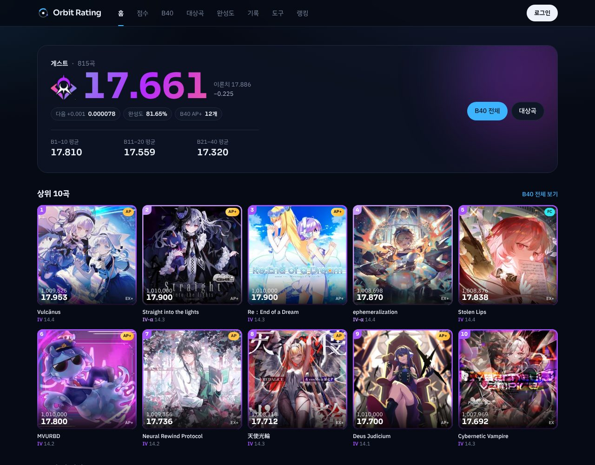
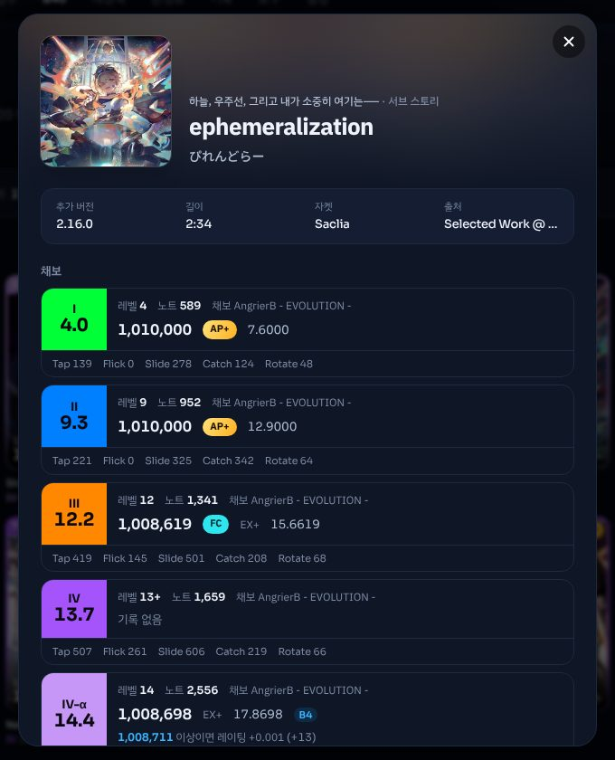
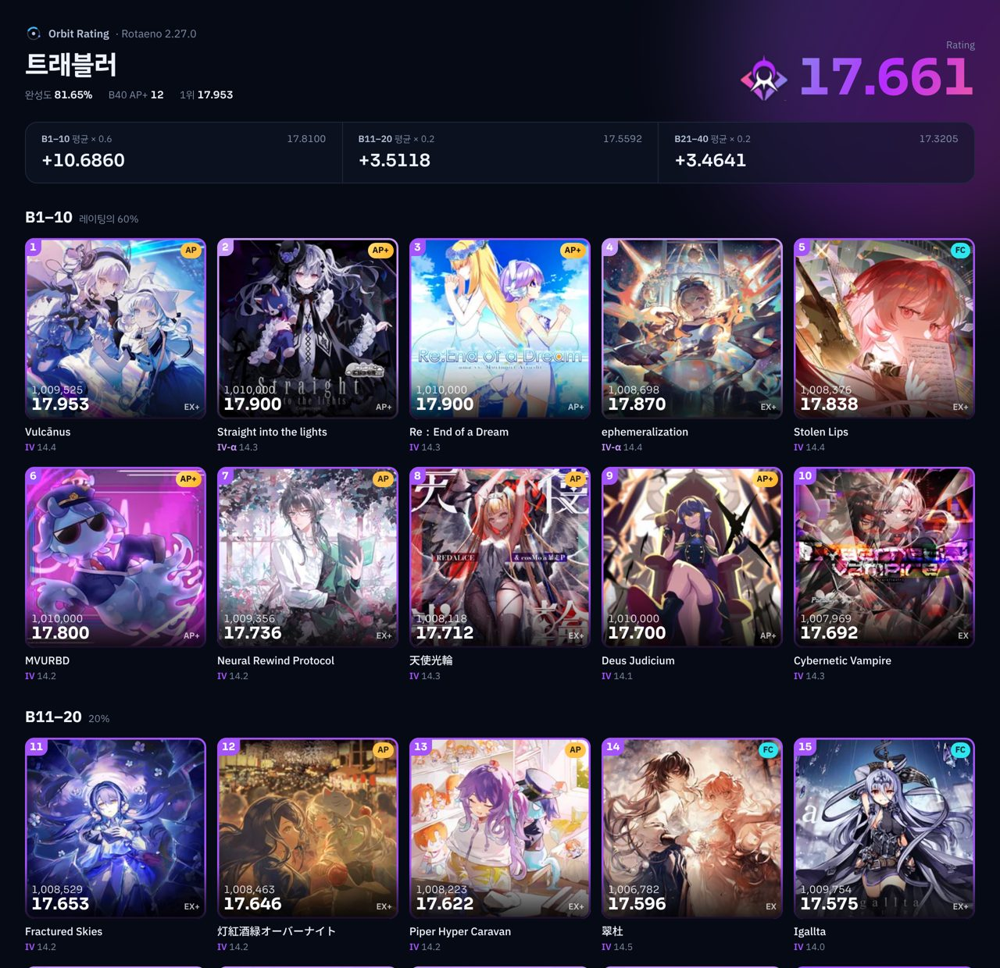

# Orbit Rating

Rotaeno 레이팅 분석 웹 서비스입니다. B40, 대상곡, 완성도를 계산하고, 점수를 계정에 동기화하고, B40을 이미지로 저장할 수 있습니다.

**사이트**: https://orbit-rating.vercel.app

계산 규칙은 커뮤니티에서 쓰는 「Rotaeno 新时代 Rating 分析表」(Artis+, 2.27.0)를 그대로 옮겼고, 테스트로 분석표와 결과가 같은지 확인합니다.

> 비공식 팬 프로젝트입니다. Rotaeno 개발사·퍼블리셔와 관계없으며, 게임 이름, 곡, 자켓 아트, 레이팅 휘장 이미지의 권리는 각 권리자에게 있습니다.

| 홈 | 곡 정보 | B40 이미지 |
| --- | --- | --- |
|  |  |  |

## 기능

| 화면 | 기능 |
| --- | --- |
| 홈 `/` | 레이팅과 휘장, 구간 평균, 상위 10곡, 다음 +0.001 추천곡, 점수 가져오기 바로가기 |
| 점수 `/scores` | 1,774개 채보의 점수·FC/AP 입력. 검색, 카테고리(한국판 팩 이름), 난이도·정수 필터, 정렬 |
| B40 `/best` | 구간별(B1–10 / B11–20 / B21–40) 자켓 타일, 이미지로 저장 |
| 대상곡 `/targets` | 채보별로 레이팅을 +0.001 올리는 최소 점수, 목표 레이팅까지의 경로 |
| 완성도 `/completion` | 완성도와 난이도 구간별 분석 |
| 채보 성향 `/insights` | 노트 구성(Tap·Flick·Slide·Catch·Rotate 비중, 노트 밀도)별로 내 평균보다 잘 치는지·못 치는지, 평소 점수보다 낮은 B40 후보곡, 약점 연습곡 |
| 악곡 정보 `/songs` | 전곡 목록. 카테고리·팩별 또는 버전별 분류, 제목·아티스트 검색, 난이도별 정수 |
| 곡 `/song/<id>` | 곡별 정적 페이지 (공유·검색용) |
| 기록 `/history` | 레이팅 변화 그래프 |
| 도구 `/tools` | 랜덤 곡, 랜덤 챌린지, 정수 연대기 |
| 랭킹 `/ranking`, `/u/<handle>` | 공개 프로필 랭킹과 공개 프로필 |
| 가져오기 `/import` | TapTap 클라우드 세이브(QR 로그인), 분석표 xlsx, JSON/CSV |
| 설정·관리 `/settings`, `/admin` | 프로필·테마, 새 버전 분석표 업로드(관리자) |

공통

- 어떤 화면이든 곡을 누르면 곡 정보 창이 열립니다. 작곡가, 팩, 버전, 길이, 채보별 정수·노트 수·채보 디자이너, 내 기록과 갱신 이력, +0.001에 필요한 점수가 나옵니다. 창을 연 주소(`?song=<id>`)를 그대로 공유할 수 있습니다.
- 점수가 오르거나 램프가 바뀔 때마다 기록이 남고, 홈에 최근 갱신이 보입니다.
- 홈 화면에 설치할 수 있고(PWA), 한 번 열어 둔 뒤에는 오프라인에서도 계산됩니다.
- 공개 프로필 링크를 붙이면 레이팅·휘장·상위 5곡이 담긴 미리보기 이미지가 뜹니다.
- 난이도 색은 게임과 같습니다 (I 초록, II 파랑, III 주황, IV 보라, IV-α 연보라).
- 클리어 표시도 게임 규칙을 따릅니다 (FC 파랑, AP 노랑, 1,010,000 무지개). 장식용 그라데이션·글로우는 쓰지 않습니다.
- 레이팅 숫자는 게임의 레이팅 휘장 구간 색으로 칠해집니다.
- 로그인하지 않아도 이 기기에 저장되고, Google로 로그인하면 계정에 동기화됩니다. Google 원탭 로그인을 지원합니다.
- 처음 로그인하면 닉네임·아이디(프로필 주소)·공개 여부를 바로 정하는 창이 뜹니다. 아이디는 입력하는 동안 사용 가능 여부를 확인합니다.
- 한국어·日本語·中文을 지원합니다. 처음 방문하면 브라우저 언어를 따르고, 상단 메뉴에서 바꿀 수 있습니다. 팩 이름은 각 언어판 공식 이름(위키 기준)을 씁니다.

## 계산 검증

계산 엔진은 `src/lib/core`에 있습니다. 2.27.0 분석표에 테스트 점수를 넣고 LibreOffice로 다시 계산한 결과(`tests/fixtures`)와 비교합니다.

- 2.27.0 분석표에 있는 1,746개 채보의 단곡 레이팅, IV/IV-α 중복 처리, 순위, B40, 구간 통계, 완성도가 분석표와 같습니다.
- +0.001 목표 점수는 채보별 이진 탐색으로 구합니다. 그 점수에서 레이팅이 오르고, 1점 낮으면 오르지 않는 것을 테스트로 확인합니다. 분석표의 역산 방식은 100만 점 미만에서 1–5점 모자라게 나올 수 있습니다.
- 이론치는 정수 연산 기준 17.886입니다. 분석표 표기 17.885는 Excel 부동소수점 TRUNC 결과입니다.

```bash
npm test                                             # 엔진·대상곡·데이터 테스트
ROTAENO_SHEET=/path/to/filled-2.27.0.xlsx npm test   # xlsx 가져오기 테스트 포함
```

## 기술 스택

- Next.js 16 (App Router), React 19, Tailwind CSS 4, TypeScript
- Supabase: Postgres + RLS, Auth(Google), Edge Function(Deno)
- `next/og` + sharp (링크 미리보기 이미지), 서비스 워커(오프라인)
- Vitest, Vercel

## 로컬에서 실행하기

필요한 것: Node.js 20 이상, Supabase 프로젝트, (선택) Supabase CLI

```bash
git clone https://github.com/4rNe5/Orbit.git
cd Orbit
npm install
cp .env.example .env.local   # 아래 값 채우기
npm run dev                  # http://localhost:3000
```

`.env.local`

| 변수 | 값 |
| --- | --- |
| `NEXT_PUBLIC_SUPABASE_URL` | Supabase 프로젝트 URL |
| `NEXT_PUBLIC_SUPABASE_PUBLISHABLE_KEY` | Supabase publishable 키 (브라우저 공개용) |
| `NEXT_PUBLIC_GOOGLE_CLIENT_ID` | (선택) Google 원탭 로그인용 OAuth 웹 클라이언트 ID. Supabase Google 로그인에 쓰는 것과 같은 ID |
| `NEXT_PUBLIC_SITE_URL` | (선택) 배포 주소. 링크 미리보기 이미지의 절대 경로에 씁니다. Vercel에서는 생략해도 됩니다 |

## Supabase 설정

1. **스키마**: `supabase/migrations`의 SQL을 순서대로 적용합니다.

   ```bash
   supabase link --project-ref <project-ref>
   supabase db push
   ```

   CLI 없이 SQL 편집기에서 파일 이름 순서대로 실행해도 됩니다.
2. **Google 로그인**: Google Cloud Console에서 OAuth 클라이언트(웹 애플리케이션)를 만들고, 승인된 리디렉션 URI에 `https://<project-ref>.supabase.co/auth/v1/callback`을 넣습니다. Client ID와 Secret을 Supabase의 Authentication → Sign In / Providers → Google에 넣습니다.
   원탭 로그인을 쓰려면 같은 OAuth 클라이언트의 "승인된 JavaScript 원본"에 `https://<배포 주소>`와 `http://localhost:3000`도 추가합니다.
3. **리디렉션 URL**: Authentication → URL Configuration에서 Site URL을 배포 주소로 하고, Redirect URLs에 `http://localhost:3000/auth/callback`과 `https://<배포 주소>/auth/callback`을 추가합니다.
4. **관리자 지정**: 한 번 로그인한 뒤 SQL 편집기에서 실행하고 다시 로그인합니다.

   ```sql
   update auth.users
   set raw_app_meta_data = raw_app_meta_data || '{"role":"admin"}'
   where email = '<관리자 이메일>';
   ```

5. **곡 데이터**: 관리자 계정으로 `/admin`에서 분석표 xlsx를 올립니다. 바뀐 정수와 새 채보를 확인한 뒤 반영하면 모든 사용자에게 적용됩니다. 그 전까지 앱은 내장된 2.27.0 데이터(`src/data`)로 계산하지만, 점수 테이블이 곡 데이터를 참조하기 때문에 계정 동기화는 업로드 후에 됩니다.

### TapTap 가져오기 (선택)

TapTap 클라우드 세이브 가져오기는 Edge Function `taptap-import`가 처리합니다. 이 기능을 쓰려면 TapTap 로그인과 게임 세이브 조회에 필요한 키를 직접 준비해야 합니다. **키 값은 이 저장소에 포함되어 있지 않습니다.**

```bash
supabase functions deploy taptap-import
supabase secrets set TAPTAP_CLIENT_ID_GLOBAL=... TAPTAP_CLIENT_ID_CN=... \
  ROTAENO_LC_KEY_GLOBAL=... ROTAENO_LC_KEY_CN=...
```

시크릿이 없으면 가져오기 화면에 "서버 설정이 끝나지 않았습니다"가 표시되고, 나머지 기능은 그대로 동작합니다.

## 곡 정보·자켓 갱신

곡 정보(`src/data/songinfo.json`)와 자켓(`public/jackets`)은 Rotaeno 중문 위키에서 가져옵니다.

```bash
npm run sync:wiki                       # 바뀐 곡 정보, 없는 자켓만 받기
node scripts/sync-wiki.mjs --refresh-jackets   # 자켓 전부 다시 받기
```

`.github/workflows/sync-wiki.yml`이 매주 월요일 이 스크립트를 돌리고, 바뀐 게 있으면 PR을 엽니다. 저장소 설정의 Actions → General에서 "Allow GitHub Actions to create and approve pull requests"를 켜 두어야 합니다. 정수는 이 스크립트로 바꾸지 않습니다.

GitHub Actions 러너에서는 위키 서버 접속이 끊겨서, Edge Function `wiki-proxy`(위키의 곡 목록·노트 통계·자켓 경로만 허용하는 읽기 전용 릴레이)를 거칩니다. 직접 운영한다면 `supabase functions deploy wiki-proxy --no-verify-jwt`로 배포하고 저장소 변수 `WIKI_PROXY`에 함수 주소를 넣으세요.

## 데이터와 보안

- 점수, 점수 갱신 기록, 레이팅 기록, 프로필은 본인만 읽고 씁니다. 점수 갱신 기록은 DB 트리거만 씁니다. 프로필을 공개하면 다른 사람도 프로필과 점수를 볼 수 있습니다.
- 곡 데이터는 누구나 읽고, `app_metadata.role = 'admin'`인 계정만 씁니다. (`user_metadata`는 사용자가 바꿀 수 있어서 권한 판단에 쓰지 않습니다.)
- TapTap 토큰과 게임 세션 토큰은 Edge Function 안에서 한 번 쓰고 저장하거나 로그에 남기지 않습니다. 세이브는 읽기만 합니다.

## 프로젝트 구조

```
src/app                 화면 (App Router)
src/components          앱 상태(AppProvider), 셸, 곡 정보 창, 타일, 공통 UI
src/lib/core            계산 엔진 (레이팅, 완성도, Excel 반올림)
src/lib/targets.ts      대상곡, 목표 레이팅 경로
src/lib/sheet.ts        분석표 xlsx 읽기 (점수, 곡 마스터)
src/lib/packs.ts        팩 이름 → 한국판 이름·카테고리
src/lib/tiers.ts        레이팅 휘장 구간과 색
src/lib/i18n.tsx        다국어(ko/ja/zh): 파일마다 defineDict로 문구를 두고 useT로 씀
src/lib/insights.ts     채보 성향 분석 (정수 대비 점수 회귀, 노트 구성별 비교)
src/lib/server          공개 프로필 요약, 링크 미리보기 이미지
src/data                내장 곡 데이터, 곡 정보, 자켓 목록
public/jackets          자켓 이미지 (256px webp, sm/ 128px)
public/sw.js            서비스 워커
public/tiers            레이팅 휘장 이미지
supabase/migrations     스키마, RLS
supabase/functions      Edge Function (TapTap 가져오기, 위키 릴레이)
scripts/extract_sheet.py  분석표 xlsx → src/data/*.json
scripts/sync-wiki.mjs   위키 → 곡 정보·자켓
tests                   Vitest
```

## 데이터 출처와 감사

| 데이터 | 출처 |
| --- | --- |
| 정수, 채보 목록, 계산 규칙 | 「Rotaeno 新时代 Rating 分析表」 (Artis+) |
| 곡 정보(작곡가, 채보 디자이너, 노트 수, 길이), 한국판 팩 이름, 레이팅 휘장 구간·이미지 | [Rotaeno 중문 위키](https://wiki.rotaeno.cn/) |
| 자켓 이미지 | [None1145/RotaAssets](https://github.com/None1145/RotaAssets), Rotaeno 중문 위키 |
| 난이도 색 참고 | [None1145/RotaBot](https://github.com/None1145/RotaBot) |

정수는 분석표를 기준으로 하고, 위키 데이터는 곡 정보 표시에만 씁니다.

## 기여

이슈와 PR 환영합니다. PR 전에 `npm run lint`와 `npm test`를 통과시켜 주세요. 정수나 계산 규칙을 바꾸는 PR은 근거가 되는 분석표 버전을 함께 적어 주세요.
